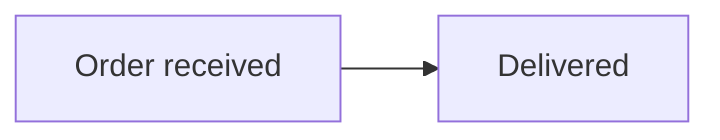

# Pele for Paseo

Renders `mermaid` and `pele` fenced blocks directly inside Paseo chat as live SVG.
All diagrams use Pele 1.7.0. The viewport is adapted directly from Paseo 0.11.4’s
Mermaid viewer: centered fit, bounded pan, zoom, toolbar and fullscreen. It runs locally,
without generating PNGs or calling a rendering service. Existing chat history
uses the renderer too.

## Install

```sh
paseo plugin add git:sojuhub/paseo-plugin-pele
```

Requires npm on the daemon host. Installation uses the committed dependency lock
and disables dependency lifecycle scripts.

For local development:

```sh
git clone https://github.com/sojuhub/paseo-plugin-pele.git
cd paseo-plugin-pele
npm ci --ignore-scripts
bun run check
paseo plugin install "$PWD"
```

Enable plugins in Paseo's settings first. After source changes use
`paseo plugin reload pele`; no daemon restart is necessary.

Tested with Paseo 0.11.4 on Mac's web client. The desktop app uses the web
rendering path. Native iOS/Android chat is left to Paseo's original renderer. Installing this plugin
does not enable native `pele` fences. The [native host patch](native-host/README.md)
adds that route using Paseo's existing Mermaid WebView shell; it requires rebuilding
and installing the app. It is not an official mobile release.

## Use

Ask an agent to produce a Mermaid diagram, or send one yourself:

````md

````

The diagram toolbar matches Paseo 0.11.4's built-in Mermaid controls: icon-only
**Zoom in**, **Zoom out**, **Reset view**, **View source** and **Fullscreen**,
in that order at the top right. Desktop controls appear on hover or keyboard
focus; compact/touch controls stay reachable. The same Lucide icons use 20 px
buttons / 14 px glyphs on desktop and 32 px / 18 px on compact layouts.
Tooltips and accessible names are English; button text and the percentage row
are removed. Source view provides **View diagram** and an icon for **Copy code**.

Fullscreen fills the browser viewport and has zoom/reset/close icons. Escape
closes it. Inline Ctrl/Command-wheel zoom, fullscreen wheel zoom, drag and
keyboard controls remain available; double-click restores the fitted view.
Pele uses Mermaid-style light/dark colors, 16px labels and explicit flowchart spacing.
Its graph layout is still Pele's, so SVG geometry is not pixel-identical to Mermaid.
The native viewport owns all fitting and centering; there is no second transform,
compact toolbar spacer or iframe. Inline height follows the natural diagram height,
with a 56px minimum and no 420px cap. Fullscreen uses native 24px fit padding.
Multiple diagrams and surrounding Markdown
are retained, and incomplete streaming input remains recoverable.

The **Pele** sidebar is a paste-and-preview editor. `/pele path/to/file.md`
opens it with the current workspace and path; press **Load**. The workspace
panel and Command Center also expose Pele. Files are read-only, limited to
200 KB and `.md`, `.markdown`, `.mmd`, `.mermaid` paths inside that workspace.
See [example.md](example.md).

## Compatibility and boundaries

- All supported syntax uses Pele, including its nine extension families.
  See [viewport provenance](client/vendor/NOTICE.md). No Mermaid runtime is bundled.
- Paseo 0.11.4 applies the **first matching timeline transformer** to a whole
  message. In the current setup, a response mixing Gen-UI `ui`/`app` blocks and
  diagrams is claimed by Gen-UI; its diagram text is not rendered by Pele.
  Separate those into different messages. Neither plugin is disabled or modified.
- The plugin cannot replace Paseo's built-in Markdown file preview or every
  tool-output widget. Use its file panel for Pele preview.
- Surrounding prose uses a small Markdown renderer. It preserves text, tables,
  lists, safe web/mail links and ordinary code; host-specific file-link actions,
  image previews and advanced Markdown extensions are not replicated.
- The browser-only component is intentionally guarded by `Platform.OS === "web"`.
  It uses a DOM container because SDK 0.11.4 has no arbitrary SVG component.
  Native mobile clients do not run its chat transformers.
- Pele disables links and images and retains source, output and edge limits. File access
  resolves symlinks and rejects paths outside the workspace. No credentials,
  transcript collection, persistence or background jobs are added.

## Verification

`bun run check` runs TypeScript plus parser, Markdown, file-boundary and actual
Pele rendering tests. The 33 diagram-family fixtures are smoke tests, not an
exhaustive guarantee for every Mermaid construct.

The current refactor passes TypeScript and 58 tests, including the upstream viewport
geometry tests and Pele's 33 diagram-family fixtures. The actual Paseo panel was
checked at desktop and 390px widths, in light/dark themes, with centered fit/reset,
keyboard pan, real mouse drag/wheel, fullscreen/Escape and invalid-source recovery.
No iframe is present. Live token-by-token streaming and workspace file-loading UI
were not repeated in this revision; their parser and file boundaries remain tested.

Real native-mobile rendering, every Mermaid syntax variant, every other
timeline-transforming plugin combination and packaged Electron UI were not
separately tested.

## License

Plugin code is MIT. Rendering uses [Pele](https://pele.run/); Markdown
parsing uses Marked. The adapted Paseo viewport is Apache-2.0; see [NOTICE](client/vendor/NOTICE.md).
