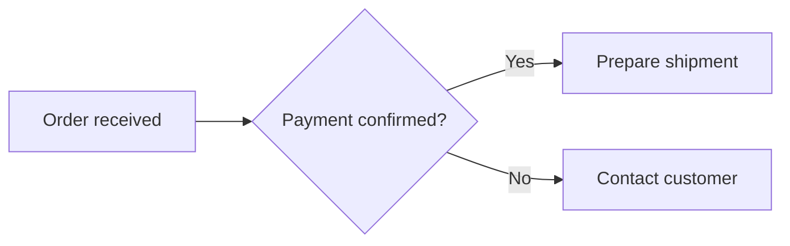

# Pele example

The **order workflow** renders as a live vector diagram, just like in chat.



| Feature | Status |
| --- | --- |
| Zoom and pan | Supported |
| Show code | Supported |

```pele
sequenceDiagram
 participant A as User
 participant B as Pele
 A->>B: Render request
 B-->>A: Vector diagram
```
